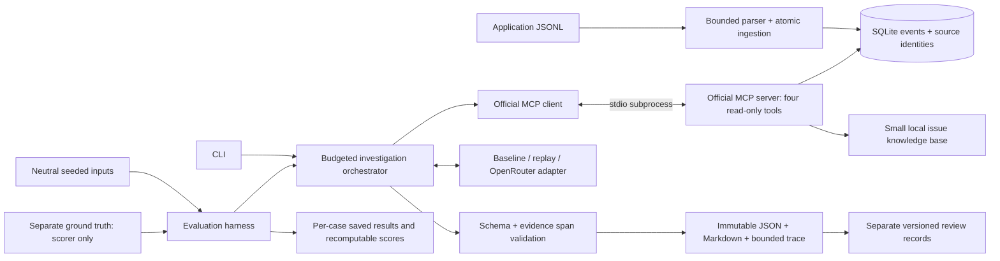

# Architecture

Log Investigator is an independent local package. No other portfolio project, remote
service, container engine or credential is required for its offline workflow.

## Boundaries

- `ingest.py` validates supported records, normalizes timestamps and assigns stable identity.
- `store.py` owns SQLite transactions, source/event persistence and deterministic queries.
- `retrieval.py` validates plain search words and contains the deliberately public issue KB.
- `mcp_server.py` exposes exactly `search_logs`, `get_event`, `trace_request`, and
  `search_known_issues`; its connection is read-only. Host startup chooses the database.
- `mcp_client.py` uses the official SDK's stdio client. Parent model credentials are
  excluded from the subprocess environment. Application diagnostics use stderr.
- `agent.py` owns scopes, budgets, rule interpretation, model/tool turns and bounded traces.
- `providers.py` contains a small protocol, scripted replay provider and actual OpenRouter HTTP adapter.
- `reports.py` validates every registered event/source span and observation reference.
  It writes original outputs exclusively and feedback to separate files.
- `demo.py` starts actual localhost API/worker child processes backed by SQLite.
- `evaluation.py` keeps answer annotations outside the investigator's inputs and tool access.

## Deterministic rules

The baseline quotes retrieved messages as observations, preserving their event IDs.
It matches explicit database-resource, retry/backlog and configuration-compatibility
signals as **likely** explanations. Conflicting signals downgrade the result.
Timeout symptoms alone yield **insufficient_evidence**, with competing explanations.
A request without failure signals may be labelled healthy; this narrow rule can
misclassify harmless warnings or recovered transient failures. It is an inspectable
baseline, not a comprehensive causal inference engine. No rule uses answer labels.

Replay exercises the same provider/tool loop using fixed protocol responses; it is
not live-model validation. Live mode uses actual model-selected tool requests and
requires schema-constrained final output. Provider failure or a budget limit produces
a partial report containing an explicitly disclosed deterministic summary of evidence
already fetched. Forged IDs or invalid draft schema produce a validation error.

## Trust and limits

Logs and issue documents are untrusted data. The system prompt states this explicitly;
the stronger boundary is the fixed four-tool allowlist, fixed provider endpoint,
dataset checks and absence of shell, browser, write or network-fetch tools. Tests
exercise malicious input and rejected capability escalation. Prompting cannot prove
that every possible model resists every injection; a model may still misinterpret
data. Citation validation proves provenance, not factual entailment or causal truth.

Tool-call count, elapsed time (including MCP startup), retrieved bytes, model turns
and model output are bounded. Provider HTTP responses also have a byte cap and timeout.
Trace entries include bounded arguments, tool duration, response size and errors;
usage includes supplied tokens and cost. Agent-owned report metadata and source spans
are assembled from retrieved evidence rather than entrusted to model output.

SQLite FTS5 is probed explicitly. A missing extension uses bounded case-insensitive
substring matching; token semantics differ from FTS5. Query text is validated plain
words, never interpolated SQL. Query values use parameters. Cross-service timestamps
are display order and do not establish causality. Request correlation does not
guarantee complete tracing.

## Limitations

The input is the documented JSONL contract, not arbitrary textual logs. Source identity
is a logical basename/content identity, not an operating-system inode. Large files
need splitting; there is no resumable bulk ingestion. There is no remote MCP endpoint,
automatic remediation, general agent runtime, UI, embeddings or custom training.
The local demo models resource admission; it does not benchmark a production database.
Independent human semantic review remains an explicit task outside automated scoring.

